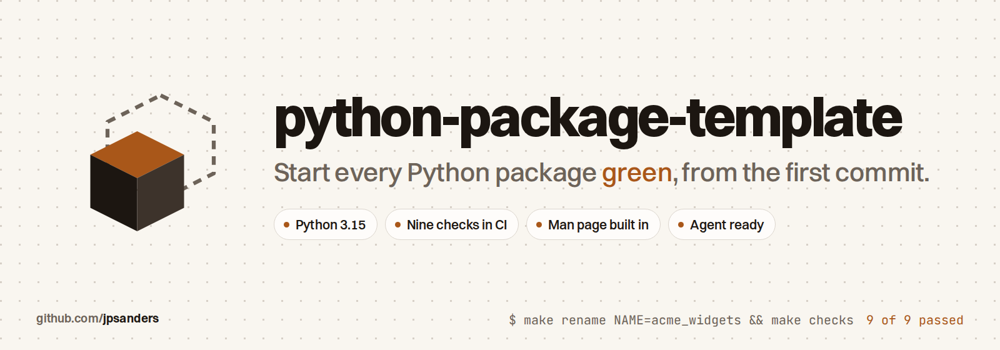

<p align="center">
  <picture>
    <source media="(prefers-color-scheme: dark)" srcset="docs/images/banner-dark.png">
    
  </picture>
</p>

<p align="center">
  <a href="https://github.com/jpsanders/python-package-template/actions/workflows/dev.yml"></a>
  <a href="https://github.com/jpsanders/python-package-template/releases/latest"></a>
  <a href="https://www.python.org/downloads/"></a>
  <a href="https://github.com/new?template_name=python-package-template&template_owner=jpsanders"></a>
  <a href="#with-an-ai-agent"></a>
  <a href="https://mypy-lang.org/"></a>
  <a href="https://github.com/psf/black"></a>
  <a href="LICENSE"></a>
  <a href="https://github.com/jpsanders/python-package-template/commits/main"></a>
  <a href="https://github.com/jpsanders/python-package-template/stargazers"></a>
</p>

A GitHub template for Python packages that are green from their first commit. Python 3.15 first, mypy in strict mode,
nine checks that run the same on your machine as in CI, a man page built from one Markdown manual, a release workflow
that attaches the wheel, and the files an AI agent needs to work in the repository without guessing.

```sh
gh repo create acme-widgets --template jpsanders/python-package-template --private --clone && cd acme-widgets
python3 scripts/rename.py acme_widgets
python3.15 -m venv .venv && . .venv/bin/activate && make init-dev && make man && make checks
```

## Why

Setting up a package properly takes an afternoon: formatter, import order, linter, docstring checks, strict types,
a security scan, tests with coverage, CI that runs the same thing, a release that builds the wheel, documentation
people can find. Skipping it is how a repository ends up with four styles and a CI nobody trusts. This template is
that afternoon, done once, and a CI job proves that a copy renamed to `acme_widgets` still passes everything.

## What you get

| Check | Tool | What it stops |
| --- | --- | --- |
| Formatting | black, 120 columns | Style arguments in review |
| Import order | isort, black profile | Noisy diffs from reordered imports |
| Whitespace | editorconfig-checker | Tabs, trailing spaces, missing final newlines and long lines, in every file type |
| Docstrings | darglint, Sphinx style | A docstring that documents parameters the function no longer takes |
| Lint | flake8 with pydocstyle and tidy imports | Unused imports and names, docstring style errors, relative imports |
| Types | mypy, strict | Untyped functions and silent `Any` |
| Security | bandit | Shell injection, unsafe deserialisation, hardcoded passwords |
| Manual | `scripts/build_man.py --check` | A man page or packaged guide that no longer matches `docs/MANUAL.md` |
| Tests | pytest with coverage | Regressions, with a coverage report on every run |

`make checks` runs all nine in CI's order and only reports. `make format` applies black and isort. `make help` lists
every target.

Around the checks:

- **CI** on every push and pull request: the checks, then pytest on Python 3.14 and 3.15 on Linux and macOS, a run
  next to a Postgres 18 service for packages that need a database, a job that installs the built wheel in a clean
  environment and runs it, and a job that renames the package and runs everything again.
- **Releases**: publish a GitHub release and the wheel and the sdist are built and attached. The version comes from
  the git tag through setuptools_scm, so there is no version number in the code to forget.
- **A man page from day one**: `docs/MANUAL.md` is the one source for `<command> guide`, `<command> man` and, after
  `<command> man --install`, plain `man <command>`.
- **Agent files**: `AGENTS.md` tells a coding agent the commands, the layout and the rules the checks enforce.
- **Community files**: a changelog, contributing notes, a security policy with private reporting, a code of conduct,
  issue forms and monthly Dependabot updates.

## Start a package

1. Click **Use this template** on GitHub, or run:

   ```sh
   gh repo create acme-widgets --template jpsanders/python-package-template --private --clone
   cd acme-widgets
   ```

2. Rename the package. This replaces the import name and the command name in every tracked file, renames the
   package, test and man page paths, and removes the files that only describe the template:

   ```sh
   make rename NAME=acme_widgets            # or: python3 scripts/rename.py acme_widgets --dist acme-widgets
   ```

3. In a virtual environment with Python 3.15 (3.14 works too), install the tools and run every check:

   ```sh
   make init-dev
   make man
   make checks
   ```

4. Replace the example in `src/acme_widgets/python_pet.py`, rewrite `docs/MANUAL.md` for your command and run
   `make man`.

`make init` installs the package on its own, without the development tools.

## With an AI agent

The repository is a Claude Code plugin with one skill, `new-python-package`, which walks an agent through steps 1 to 4
above and the rules to keep afterwards:

```text
/plugin install python-package-template --marketplace jpsanders/python-package-template
```

On Claude Code before 2.1.275, add the marketplace first: `/plugin marketplace add jpsanders/python-package-template`,
then `/plugin install python-package-template@python-package-template`. Other agents can read the skill directly from
[`skills/new-python-package/SKILL.md`](skills/new-python-package/SKILL.md); Codex and OpenCode load the same file
from their own skills folders.

Inside a package made from the template, `AGENTS.md` is what an agent reads first. The example command follows the
conventions an agent relies on: every command takes `--json` and prints one object with stable fields, and
`<command> guide` prints the whole manual, so an agent can learn the tool without a browser.

## The example command

```text
$ python-template feed --times 2 --json
{"name": "Baby Python", "hunger": 3, "happiness": 5}
$ python-template guide | head -1
# python-template
$ python-template man --install && man python-template
```

It is a placeholder that shows the shape: one `cmd_*` function per command in `cli.py`, a manual in `docs/MANUAL.md`,
tests that exercise the command line.

## Layout

```text
src/python_template/        the package, with py.typed so type checkers trust its hints
src/python_template/data/   the packaged manual and man page, generated by make man
docs/MANUAL.md              the one source for the guide and the man page
tests/python_template/      pytest tests, mirroring the package
scripts/                    build_man.py, and rename.py for the one time rename
.github/                    CI from reusable workflows, the release, issue forms, Dependabot
AGENTS.md                   instructions for coding agents
Dockerfile                  an image built from source on python:3.15-slim, running without root
Makefile                    every command in this file
```

## Versions

Tag a commit with the bare version, `git tag -s 1.0.0 -m 1.0.0`, and `make build` writes a 1.0.0 wheel to
`build/dist`. Untagged commits build as development versions such as `1.0.1.dev3+g1a2b3c4`. The release workflow
checks that the README's release badge names the version it is releasing.

## CI details

The building blocks are reusable workflows with inputs, so a single check can be switched off, for example with
`enable-bandit: false`. To install dependencies from a private package index, store the index URL with its
credentials as the `PKG_REPOSITORY` secret. CI passes it to pip as an extra index.

## Docker

```sh
make build-docker
docker run --rm python-template:latest
```

The image runs as an unprivileged user. The build mounts `.git` read only so setuptools_scm can version the install,
which needs BuildKit, the default builder in current Docker.

## Notes

Files that belong to one developer, such as `.envrc` or `.python-version`, go in your global ignore file,
`~/.gitignore`. The repository's `.gitignore` lists only what the code itself produces.

Issues and pull requests are welcome; see [CONTRIBUTING.md](CONTRIBUTING.md).

## Star history

<a href="https://star-history.com/#jpsanders/python-package-template&Date">
  <picture>
    <source media="(prefers-color-scheme: dark)" srcset="https://api.star-history.com/svg?repos=jpsanders/python-package-template&type=Date&theme=dark">
    
  </picture>
</a>

## Licence

MIT. Made by [James Phillip Sanders](https://jamesphillipsanders.com).
